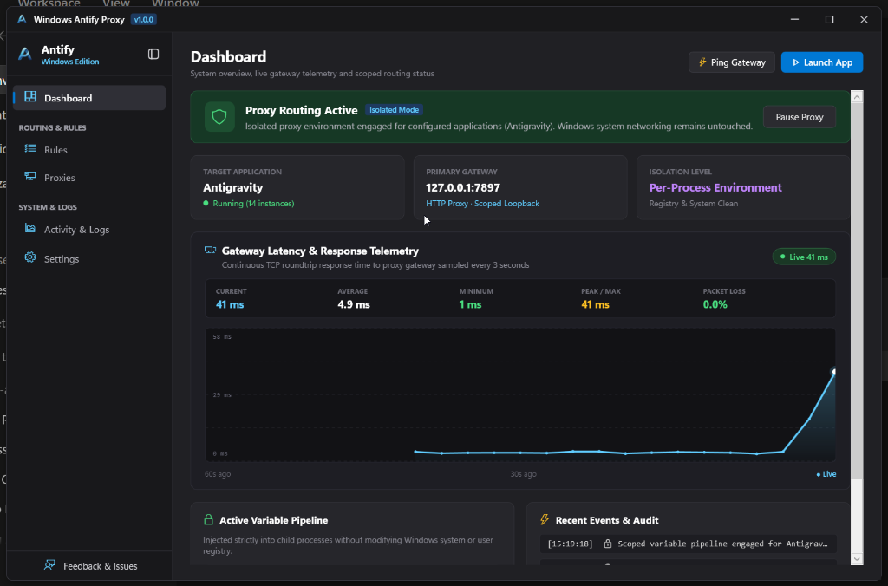
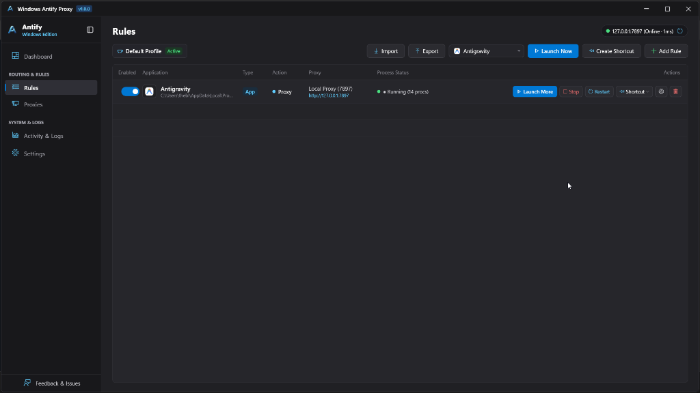

<div align="center">


# Win Antify Proxy (Windows Antify Proxy)

**Per-Process Isolated Proxy & Environment Variable Manager for Windows**

**专为 Windows 打造的单进程网络代理与环境变量隔离工具**

[-blue.svg?logo=windows&logoColor=white)](https://github.com/mahmoud-abdalla-eg/windows-antify-proxy)
[](https://dotnet.microsoft.com/)
[](https://github.com/mahmoud-abdalla-eg/windows-antify-proxy/releases)
[](LICENSE)
[](https://github.com/mahmoud-abdalla-eg/windows-antify-proxy/pulls)

---

### [English](#-english) · [简体中文](#-简体中文) · [Keywords / 关键词](#-search-keywords--关键词优化)

---

</div>

<br/>

<div align="center">
  
  <br/><br/>
  <details>
    <summary><b>📸 Click to preview Rules &amp; Process Control Management View (规则列表与进程管理)</b></summary>
    <br/>
    
  </details>
</div>

<br/>

---

## 🌐 English

### 📖 Overview

**Win Antify Proxy** (Windows Antify Proxy) is a lightweight, native Windows desktop utility designed to inject and scope proxy environment variables (`HTTP_PROXY`, `HTTPS_PROXY`, `ALL_PROXY`, `NO_PROXY`, SOCKS5) strictly into targeted application processes—such as **Antigravity**, **Cursor**, **VS Code**, **Git**, **Terminal**, or any developer executable.

Modeled after and visually inspired by [Antify](https://antifyapp.com/en/) ([cyberlesterr/antify-feedback](https://github.com/cyberlesterr/antify-feedback)) on macOS, Win Antify Proxy brings first-class, seamless per-process proxy scoping to Windows developers.

---

### 💥 The Problem Win Antify Proxy Solves

When developers and power users configure proxy tools (like Clash, Clash Verge, v2ray, Sing-box, Shadowsocks, Fiddler, Charles):

1. **System-wide / Global Environment Variable Pollution:**
   - Setting global user variables (`HTTP_PROXY` or `HTTPS_PROXY`) forces **every** app on Windows through the proxy.
   - Multiplayer games (Valorant, CS2, League of Legends, Apex Legends) may crash, experience massive latency, or trigger **anti-cheat bans** due to unrecognized proxy IP routing.
   - Local development servers (`localhost`, `127.0.0.1`, internal intranet LAN) frequently break or fail to resolve.
2. **TUN / TAP Virtual Network Adapter Drawbacks:**
   - TUN mode captures all system packet traffic at the driver level, consuming noticeable CPU and battery.
   - Drivers can conflict with WSL2, Docker, Hyper-V, and corporate VPN clients (Cisco AnyConnect, Fortinet, WireGuard).
3. **The Win Antify Proxy Solution:**
   - Zero TUN adapters. Zero system variable leakage.
   - Win Antify Proxy launches your target program in an **isolated user-space process environment block**.
   - Only the designated app communicates via your proxy—the rest of your Windows system remains 100% direct and untouched.

---

### 🌟 Key Features

- 🛡️ **Per-Process Environment Isolation:**
  Inject `HTTP_PROXY`, `HTTPS_PROXY`, `ALL_PROXY`, and custom variables exclusively into target executables.
- ⚡ **Zero TUN / No Kernel Driver Required:**
  Operates purely in user-space with no virtual network drivers, no driver crashes, and no anti-cheat false flags.
- 🛑 **Built-in Kill Switch (Leak Prevention):**
  Actively verifies if your local proxy port (e.g. `127.0.0.1:7897`) is listening before launching the application. If the proxy server is offline, the launch is automatically blocked to prevent accidental leaks of your real IP.
- 🎯 **Always-Accessible Process Control:**
  - **`▶ Launch Now` Button:** Permanently pinned on the top window title bar and on each rule item.
  - **`⏹ Stop` Button:** Terminate running instances in 1-click without opening Windows Task Manager.
  - **`🔄 Restart` Button:** Cleanly restart the target process with freshly updated proxy variables.
  - **Live Process Tracking:** Real-time badge indicators show `● Running (PID: xxxx)` vs `○ Stopped`.
- 🚀 **1-Click Native Desktop & Start Menu Shortcuts:**
  Interactive dialog allows creating Windows `.lnk` shortcuts on your **Desktop**, **Start Menu**, or **Taskbar** with `--launch-rule "<Name>"` arguments for 1-click direct launches.
- 🌐 **Multi-Protocol & Custom Env Support:**
  Compatible with HTTP, HTTPS, and SOCKS5 proxies. Easily define custom environment variables (e.g., `NODE_EXTRA_CA_CERTS`, `GIT_SSL_NO_VERIFY`, `PYTHONHTTPSVERIFY`).
- 🎨 **Windows 11 Fluent Dark UI:**
  Built with .NET 8 WPF featuring clean dark aesthetic, glassmorphism, responsive drawer panels, and live ping latency testing.
- 📦 **Single-File Portable Binary:**
  Pre-compiled standalone executable. No installation, no admin registry edits, ready to run.

---

### 📊 Comparison: Win Antify Proxy vs Alternatives

| Feature | Win Antify Proxy | Global Windows Proxy / Env | TUN Virtual Adapter Mode |
| :--- | :---: | :---: | :---: |
| **Per-App Isolation** | ✅ **100% Isolated** | ❌ Affects entire OS | ⚠️ Requires complex route rules |
| **Game Anti-Cheat Safe** | ✅ **100% Safe (User space)** | ❌ Risk of bans / high ping | ⚠️ Often blocked by anti-cheat |
| **Localhost / Intranet Clean** | ✅ **Untouched** | ❌ Often broken by proxy | ⚠️ Needs route bypass tables |
| **Kernel / Driver Overhead** | ✅ **Zero drivers** | ✅ No drivers | ❌ Requires TAP/TUN drivers |
| **Leak Prevention (Kill Switch)** | ✅ **Built-in** | ❌ No | ⚠️ Depends on client |
| **1-Click Desktop Shortcuts** | ✅ **Yes** | ❌ No | ❌ No |
| **Process Control (Start/Stop/PID)** | ✅ **Yes** | ❌ No | ❌ No |

---

### 🚀 Building from Source

#### Prerequisites
- Windows 10 (version 1809 or higher) or Windows 11 (64-bit)
- [.NET 8.0 SDK](https://dotnet.microsoft.com/download/dotnet/8.0) (Desktop Runtime)

#### Build Commands
```powershell
# 1. Clone the repository
git clone https://github.com/mahmoud-abdalla-eg/windows-antify-proxy.git
cd windows-antify-proxy/app

# 2. Build Release configuration
dotnet build -c Release

# 3. Publish standalone single-file binary
dotnet publish -c Release -r win-x64 --self-contained false -p:PublishSingleFile=true -o ../release
```

---

### ⌨️ Command Line (CLI) Support

Win Antify Proxy supports command line switches for automation and desktop shortcuts:

```powershell
# Launch a specific configured rule directly:
WindowsAntifyProxy.exe --launch-rule "Antigravity"

# Launch and bypass the Kill Switch validation:
WindowsAntifyProxy.exe --launch-rule "Antigravity" --bypass-killswitch

# Launch with extra command line arguments passed to the target app:
WindowsAntifyProxy.exe --launch-rule "Antigravity" --args "--verbose"
```

---

### 📁 Repository Structure

```
windows-antify-proxy/
├── app/                              # Native .NET 8 WPF Desktop Client
│   ├── Converters/                   # UI data converters
│   ├── Models/                       # AppSettings, RuleItem, ProxyItem models
│   ├── Services/                     # ProcessLauncher, ShortcutService, ProcessMonitor
│   ├── MainWindow.xaml               # Windows 11 Fluent UI & drawer overlays
│   ├── MainWindow.xaml.cs            # Live tracking & process control handlers
│   └── WindowsAntifyProxy.csproj     # Project config & build properties
├── docs/                             # Technical Documentation
│   ├── overview.md                   # Problem definition and feature summary
│   ├── architecture.md               # Process Environment Block internals
│   ├── configuration.md              # JSON schema and settings storage
│   └── api-reference.md              # Internal services and models reference
├── assets/                           # Screenshots, logos, and UI graphics
├── LICENSE                           # MIT License
├── README.md                         # Bilingual documentation & guide
└── README_CN.md                      # Dedicated Simplified Chinese documentation
```

---

<br/>

## 🇨🇳 简体中文

### 📖 项目简介

**Win Antify Proxy** (Windows Antify Proxy) 是一款专为 Windows 10 与 Windows 11 打造的轻量级、原生桌面代理环境隔离工具。它的核心功能是将代理环境变量（`HTTP_PROXY`、`HTTPS_PROXY`、`ALL_PROXY`、`NO_PROXY` 及 SOCKS5）**严格限制在指定的应用程序进程内**（例如 **Antigravity**、**Cursor**、**VS Code**、**Git**、**Python**、命令行终端或任意 `.exe` 软件）。

本项目深度致敬并参考了 macOS 平台的 [Antify](https://antifyapp.com/en/) ([cyberlesterr/antify-feedback](https://github.com/cyberlesterr/antify-feedback))，为 Windows 平台开发者带来了同样丝滑、直观、免污染的单应用代理分流体验。

---

### 💥 解决的核心痛点

在日常开发与日常使用中，许多开发者常使用 Clash、Clash Verge、v2rayN、Sing-box 等代理客户端：

1. **系统全局环境变量污染痛点：**
   - 很多教程建议在 Windows 系统中设置全局 `HTTP_PROXY` 环境变量，导致整个操作系统的所有软件都被强制走代理。
   - 竞技游戏（无畏契约/Valorant、英雄联盟/LOL、CS2、Apex 英雄等）误走代理节点，导致网络延迟暴增甚至被游戏反作弊系统误封（Anti-Cheat Ban）。
   - 本地开发服务（`localhost`、`127.0.0.1`、局域网内网穿透、公司内网系统）常因代理拦截而无法访问。
2. **TUN 虚拟网卡模式的弊端：**
   - TUN 模式会在系统底层创建虚拟网卡接管所有流量，CPU 占用高、容易造成网络抖动或断流。
   - 极易与 WSL2、Docker Desktop、Hyper-V 以及企业级 VPN（如 Cisco AnyConnect、WireGuard、Fortinet）发生网卡路由冲突。
3. **Win Antify Proxy 的优雅解决方案：**
   - **零 TUN 网卡驱动、零全局变量污染**。
   - 采用纯用户态进程环境块注入技术（Environment Variable Scoping），在启动软件的瞬间仅向其子进程注入独立代理参数。
   - 目标开发软件畅享代理加速，而宿主系统、局域网流量和大型网游保持 100% 直连，互不干扰！

---

### 🌟 核心功能特性

- 🛡️ **单进程级环境隔离（Per-Process Isolation）：**
  将 `HTTP_PROXY`、`HTTPS_PROXY`、`ALL_PROXY` 仅注入至选定的目标软件，不污染 Windows 注册表和系统环境变量。
- ⚡ **免 TUN / 零内核驱动冲突：**
  纯用户空间运行，无需安装 WinTUN/TAP 驱动，不占系统底层网卡，杜绝游戏反作弊误报与网络卡死。
- 🛑 **独家 Kill Switch 防泄漏断网保护：**
  启动应用前主动探测本地代理端口（默认 `127.0.0.1:7897`，支持自定义）是否正常监听。若代理客户端未开启，自动拦截启动，防止真实 IP 裸奔泄露。
- 🎯 **随时可用的进程管理与控制：**
  - **`▶ 立即启动`：** 顶部窗口标题栏与每条规则行常驻，一触即发。
  - **`⏹ 一键停止`：** 无需翻找 Windows 任务管理器，一键优雅终止目标进程。
  - **`🔄 一键重启`：** 修改代理配置后，一键自动应用新环境并重启软件。
  - **实时进程监控：** 动态显示当前运行状态及系统 PID（`● 运行中 (PID: xxxx)` / `○ 已停止`）。
- 🚀 **一键生成独立桌面 / 开始菜单快捷方式：**
  交互式对话框支持为应用生成指向 **桌面**、**开始菜单** 或 **任务栏** 的专属快捷方式，双击图标即可直接以隔离代理模式启动！
- 🌐 **多协议兼容与自定义环境变量：**
  全面兼容 HTTP、HTTPS、SOCKS5 代理协议，并支持自由增加任意环境变量（如 `NODE_EXTRA_CA_CERTS`、`GIT_SSL_NO_VERIFY`、自定义 API Key 等）。
- 🎨 **原生 Windows 11 Fluent 现代深色界面：**
  基于 .NET 8 WPF 构建，采用流畅的 Fluent 亚克力质感与深色主题，内置代理 Ping 延迟测试与侧边抽屉面板。
- 📦 **绿色单文件便携免安装：**
  支持直接编译发布单文件绿色版 `.exe`，双击即用，随身携带，不写系统冗余残留。

---

### 📊 方案深度横向对比

| 功能特性对比 | Win Antify Proxy | 全局系统代理 / 系统环境变量 | TUN 虚拟网卡接管模式 |
| :--- | :---: | :---: | :---: |
| **单应用精准代理** | ✅ **100% 进程级独立隔离** | ❌ 全局生效，殃及其他程序 | ⚠️ 需要复杂配置分流规则 |
| **网络游戏防封号/低延迟** | ✅ **完全直连，绝不串流** | ❌ 极易误走代理导致封号 | ⚠️ 易被游戏反作弊模块拦截 |
| **本地服务 / 局域网内网** | ✅ **原生直连，零破坏** | ❌ 经常被代理劫持导致报错 | ⚠️ 需要手动配置绕过 IP 段 |
| **虚拟网卡 / 驱动负担** | ✅ **零驱动，纯用户态** | ✅ 无驱动 | ❌ 需安装 TAP/TUN 虚拟网卡 |
| **Kill Switch 断网防泄漏** | ✅ **内置主动端口探活** | ❌ 无此保护机制 | ⚠️ 依赖客户端具体实现 |
| **一键生成独立桌面图标** | ✅ **原生支持生成快捷方式** | ❌ 不支持 | ❌ 不支持 |
| **进程实时监控 (PID/启停)** | ✅ **内置实时监控** | ❌ 不支持 | ❌ 不支持 |

---

### 🚀 快速上手与源码构建

```powershell
# 1. 克隆代码仓库
git clone https://github.com/mahmoud-abdalla-eg/windows-antify-proxy.git
cd windows-antify-proxy/app

# 2. 编译发布单文件版本
dotnet publish -c Release -r win-x64 --self-contained false -p:PublishSingleFile=true -o ../release
```

运行程序后：
1. **配置本地代理：** 默认代理端口为 `127.0.0.1:7897`（Clash / Clash Verge 默认端口），点击 **Ping** 验证连接。
2. **添加或勾选目标程序：** 默认预设并自动扫描检测 **Antigravity**，亦可自由添加 Cursor、VS Code、Git 等。
3. **一键启动：** 点击顶部标题栏或规则卡片中的 **`▶ 立即启动`** 即可在隔离网络环境中运行。

---

### 💻 命令行自动化使用

```powershell
# 通过命令行直接启动指定的规则应用：
WindowsAntifyProxy.exe --launch-rule "Antigravity"

# 跳过 Kill Switch 代理端口探活检查直接启动：
WindowsAntifyProxy.exe --launch-rule "Antigravity" --bypass-killswitch

# 启动并向目标应用传递额外的运行参数：
WindowsAntifyProxy.exe --launch-rule "Antigravity" --args "--new-window"
```

---

<br/>

## 🏷️ Search Keywords / 关键词优化

To help developers, gamers, and users find this repository easily on GitHub and search engines, the following keywords are indexed:

### 🇬🇧 English Keywords
`windows proxy`, `per-process proxy`, `per-app proxy windows`, `isolate proxy windows`, `antify windows`, `antify for windows`, `antigravity proxy`, `antigravity`, `antigravity tool`, `http_proxy`, `https_proxy`, `all_proxy`, `socks5 proxy windows`, `clash windows per app`, `clash verge per-process`, `v2ray per app`, `sing-box windows proxy`, `selective proxy`, `transparent proxy windows`, `environment variable proxy`, `proxy isolation`, `no tun proxy`, `anti cheat safe proxy`, `kill switch proxy windows`, `developer proxy tool`, `cursor proxy`, `vscode proxy`, `git proxy windows`, `windows 11 fluent dark`, `dotnet 8 wpf proxy`.

### 🇨🇳 中文搜索关键词
`Windows代理`, `Windows代理工具`, `单应用代理`, `应用分流代理`, `进程代理`, `局部代理`, `环境变量代理`, `Antigravity 代理`, `Antigravity Windows`, `Antify Windows版`, `Clash 指定应用代理`, `Clash Verge 分流`, `Clash 进程代理`, `免 TUN 模式代理`, `防止游戏误代理`, `防游戏串流封号`, `英雄联盟代理避让`, `无畏契约代理避让`, `CS2 代理避让`, `开发工具代理`, `AI 编程代理`, `Cursor 代理`, `VSCode 代理`, `Git 代理设置`, `指定进程走代理`, `避免全局代理污染`, `Kill Switch 防泄漏`, `本地代理端口探活`, `Windows 进程级代理隔离`, `单软件独立代理`.

---

## 📚 Technical Documentation

Explore deep dive guides inside the [`docs/`](docs/) directory:
- 📖 [Project Overview](docs/overview.md)
- 🏗️ [Architecture & Internals](docs/architecture.md)
- ⚙️ [Configuration & Settings](docs/configuration.md)
- 🔌 [API & Code Reference](docs/api-reference.md)

---

## 💬 Community, Feedback & Issues

Have a question, feedback, feature request, or found a bug?
- 🐛 **Submit an Issue:** [Open a GitHub Issue](https://github.com/mahmoud-abdalla-eg/windows-antify-proxy/issues)
- 💡 **Pull Requests:** PRs and community contributions are very welcome!

---

## 📜 License & Acknowledgments

- **License:** Released under the [MIT License](LICENSE).
- **Inspiration:** Conceptual and visual inspiration from [Antify](https://antifyapp.com/en/) by [@cyberlesterr](https://github.com/cyberlesterr/antify-feedback).
- **Author:** [Mahmoud Abdalla](https://github.com/mahmoud-abdalla-eg)

<div align="center">
  <sub>Made with ❤️ for the global developer community. Star ⭐ this repo if it helped your workflow!</sub>
</div>
